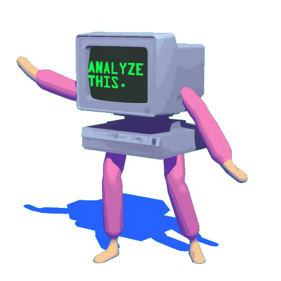

<!-- Calm Forest Landscape Under Clouds Banner -->
 
<!-- Typing SVG Animation -->

  
  
  

---

<h2 align="center">
  ABOUT ME 
</h2>

---

- 🍁 **Full Name**: Do Duc Minh Quang
- 📍 **Location**: Ha Noi Capital, Viet Nam
- 💼 **Profession**: Backend & AI Engineer
- 🎓 **University**: University of Transport and Communications (UTC)
- 🌱 **Currently learning**: Computer Vision & Blockchain
- 📫 **How to reach me**: [minhquang.do1822@gmail.com](mailto:minhquang.do1822@gmail.com)

---

<h2 align="center">
  TECH STACK 
</h2>

---

  
  
  
  
  
  
  
  
  
  
  
  
  
  
  
  
  
  
  
  
  
  
  

---

<h2 align="center">
  GITHUB STATS
</h2>

  

---

<table align="center">
  <tr>
    <td align="center" valign="top">
      
    </td>
    <td align="center" valign="top">
      
    </td>
    <td align="center" valign="top">
      
    </td>
  </tr>
</table>

<table align="center">
  <tr>
    <td align="center" valign="top">
      
    </td>
    <td align="center" valign="top">
      
    </td>
  </tr>
</table>

  

---

  🌱 <i>"Continuous learning and steady progress."</i> 🌱

